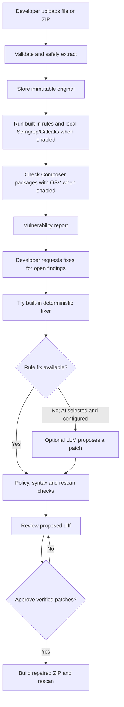

# NexaPatch AI

**AI-powered security repair for vulnerable application code.**
Upload your code, get the weaknesses found, fixed with minimal changes, and verified, without rewriting your application logic.

> **Project status:** Core product works: sign up / log in, upload code (ZIP or file), built-in security rules, optional local Semgrep/Gitleaks scans, Composer dependency checks, findings with fix advice, PDF report, and dashboard. Quick start: `QUICKSTART_WINDOWS.md`.

---

## Why NexaPatch AI?

Many companies now build apps and websites quickly with AI coding assistants such as ChatGPT. The code works, but security is rarely reviewed, and most small and mid-size IT companies have no dedicated security engineer.

NexaPatch AI closes that gap:

1. **Upload** a source file or a project ZIP.
2. **Scan** it for security vulnerabilities.
3. **Fix** each issue with the smallest possible security-only patch.
4. **Verify** the patch (syntax, security rescan, tests) in an isolated sandbox.
5. **Review and download** the repaired project after human approval.

> **Core principle:** *Do not rewrite the application to fix its security. Make the smallest justified security change, then verify that the application still behaves as expected.*

---

## Key Features

| Feature | Description |
|---|---|
| Upload and safe extraction | Single files or ZIP projects, with protection against zip bombs, symlinks and path traversal |
| Source scanning | Built-in rules; optional local Semgrep and Gitleaks; OSV lookup for Composer dependencies |
| Clear explanations | Why it is dangerous, possible impact, remediation, CWE / OWASP references |
| Confirmed vs. potential findings | Findings that need manual review are labelled honestly |
| Repair proposals | Deterministic PHP rules first; optional LLM fallback when configured and selected |
| Policy Gate | Automatically rejects patches that touch unrelated lines, rename functions or change signatures |
| Diff review | Side-by-side original vs. modified code with a change summary |
| Verification | Patch policy checks, supported syntax checks and a source rescan; no Docker test sandbox is currently wired in |
| Human approval | Nothing is accepted or downloadable without reviewer approval |
| Reports and history | PDF security report, scan history, dashboard, audit log |
| Immutable original | The uploaded baseline is hashed and never overwritten; rollback is always possible |

---

## How It Works



---

## Architecture

```
Browser
   |
Laravel (PHP) ---> MySQL
   |                Private upload storage (original = immutable)
   |- PHP rule-based source scanner
   |- Optional OSV lookup (Composer package names and versions only)
   |- Optional local Semgrep and Gitleaks processes
   `- Optional LLM patch helper (small, redacted code window only)
```

Uploaded code is read for scanning and patch proposals; the current application
does not execute uploaded code or run a Docker verification sandbox. The
Semgrep and Gitleaks adapters run locally when enabled and installed. Semgrep
may download its configured ruleset; uploaded source is not sent to Semgrep or
Gitleaks as a hosted service. See [docs/SECURITY_SCANNERS.md](docs/SECURITY_SCANNERS.md)
for installation, configuration, and current coverage limitations.

### Tech Stack

| Layer | Technology |
|---|---|
| Frontend | HTML, CSS, JavaScript, Bootstrap |
| Web backend | PHP / Laravel |
| Security scanning | Built-in rules; local Semgrep and Gitleaks; OSV.dev for Composer packages |
| Optional AI integration | Gemini or OpenAI-compatible provider (for example Groq/OpenRouter/Ollama) |
| Database | MySQL |
| Optional scanner adapter | Python Semgrep/Gitleaks script, invoked by Laravel when enabled |
| Queue | Laravel Queue (sync mode for local development; database queue available) |
| Isolated testing | Not currently integrated |
| Hosting | Ubuntu Server on Proxmox |

---

## Example Fixes (PHP MVP)

| Vulnerability | Typical fix |
|---|---|
| SQL Injection | Replace string-built queries with PDO prepared statements |
| XSS | Encode output with `htmlspecialchars(..., ENT_QUOTES, 'UTF-8')` |
| CSRF | Add token generation and verification to forms and handlers |
| Hardcoded secrets | Move values to environment variables |
| Weak password hashing | Use `password_hash` / `password_verify` |
| Insecure file upload | Extension/MIME allow-list, size limit, random file names |

Some fixes (for example a password-hash migration) need a manual step. Those patches are marked **Needs Manual Step** and list exactly what the developer must do.

---

## Core Policies

1. The original source is never overwritten.
2. AI patches must be reviewed by a human before acceptance.
3. Only security-related changes are proposed.
4. Business logic and public function signatures are not intentionally changed.
5. Every change appears in a reviewable diff.
6. Every patch is independently rescanned.
7. Existing tests are run where available.
8. Failed or incomplete verification is reported honestly (**Unverified**, never hidden).
9. Untrusted code never runs on the main server.
10. All execution happens in isolated, resource-limited, network-disabled containers.
11. Patched code is never deployed to production automatically.
12. A human reviewer controls acceptance and download.

---

## Current Project Structure

```
nexapatch-ai-final-patch/
|- app/                  # Laravel backend: controllers, models, jobs, services
|  |- Http/Controllers/  # Request handling; Auth/ and Admin/ are subgroups
|  |- Jobs/              # Background tasks such as RunScan and RunFix
|  |- Models/            # Database records and relationships
|  |- Policies/          # Authorization rules (e.g. ProjectPolicy)
|  `- Services/          # Business logic, upload, scanning and fixing
|- bootstrap/            # Laravel startup and route registration
|- config/               # Application configuration
|- database/             # Migrations, factories and seeders
|- docs/                 # Project structure and developer documentation
|- docker/               # Container and web-server configuration
|- engine/               # Optional Python security-tool adapter
|- public/                # Public entry point and browser assets (CSS/JS)
|- resources/
|  |- security/           # Scanner rules/configuration
|  `- views/              # Frontend pages and layouts (Blade templates)
|- routes/                # Web routes
|- storage/               # Runtime files, logs, cache and private uploads
|- tests/                 # Feature tests and test fixtures
|- artisan                # Laravel command-line entry point
`- composer.json          # PHP dependencies and App\\ autoload mapping
```

For a fuller map, request flow and help choosing the right file to edit, see
[docs/PROJECT_STRUCTURE.md](docs/PROJECT_STRUCTURE.md).

## Getting Started

Follow [QUICKSTART_WINDOWS.md](QUICKSTART_WINDOWS.md) for the setup steps that match
this repository. This project is a Laravel application at its root; there is no
separate `web/` directory or standalone Python worker setup in the current code.

---

## Roadmap

| Phase | Focus | Estimate |
|---|---|---|
| 1. Foundation | Auth, RBAC, projects, safe upload, database, audit log | 3-4 weeks |
| 2. Scanner | Semgrep, Gitleaks, OSV integration, findings UI, queue | 3-4 weeks |
| 3. AI Repair | LLM wrapper, prompts, Policy Gate, diff viewer | 4 weeks |
| 4. Verification | Docker sandbox, syntax check, rescan, test runner | 3 weeks |
| 5. Reports and Admin | PDF report, patched ZIP, dashboard, admin panel | 2-3 weeks |
| 6. Hardening | Security testing, benchmarks, docs, demo | 2 weeks |

Estimates assume one to two part-time developers and may change.

**Future:** JavaScript, Python and Laravel-specific support, GitHub/GitLab pull requests, CI/CD integration, automated test generation, on-premises deployment with a local LLM, team approval workflows.

---

## MVP Success Targets

- At least 80% of seeded issues detected on benchmark vulnerable PHP apps
- At least 70% of eligible findings fixed (target finding gone, syntax valid)
- 0 accepted patches that change unrelated lines
- 0 broken behaviors on test-covered benchmark apps
- Upload to first report in under 5 minutes for a 5 MB project

---

## Security and Privacy

- Uploaded code is treated as untrusted input and encrypted at rest.
- Secrets are redacted before any code is sent to the LLM or written to logs.
- Customer code is not used for model training.
- Configurable retention and deletion policies per project.
- Rate limiting on login, upload and AI endpoints.

To report a vulnerability in NexaPatch AI itself, please open a private security advisory or contact the maintainer directly instead of a public issue.

---

## Limitations

- NexaPatch AI does **not** guarantee that an application is fully secure.
- AI-generated patches can be wrong; that is why every patch goes through the Policy Gate, verification and human review.
- Static analysis can produce false positives and miss logic flaws.
- The first release supports PHP only.
- It is a defensive tool: use it only on code you own or are authorized to test.

---

## Documentation

- `docs/NexaPatch_AI_SRS_v2.docx`: full Software Requirements Specification with use case, architecture, deployment, workflow, sequence, state, data flow and ER diagrams.

---

## Contributing

The project is in an early stage. Ideas, issues and pull requests are welcome once the foundation phase is published. Please keep changes small and include tests.

## License

To be decided (for example MIT or a proprietary license). Add a `LICENSE` file before publishing.

## Author

**Muhammad Tayyab**
GitHub: [github.com/tayyabp0g](https://github.com/tayyabp0g) | Portfolio: [aiwithtayyab.vercel.app](https://aiwithtayyab.vercel.app)
